<h1 align="center">Inventory &amp; Delivery Management System</h1>
<p align="center"><em>A role-based web application built on React, Flask and MySQL</em></p>
<p align="center"><strong>DBMS Project Report</strong><br>Department of Computer Science and Engineering (CSE)<br>Indian Institute of Information Technology, Bhopal<br>Academic Year 2026 - 2027</p>

<p align="center">
  <a href="https://dbms-plum.vercel.app">Live demo</a> &middot;
  <a href="https://github.com/tanishkyadav1617/DBMS">Source code</a>
</p>

---

## Project Team

| Name | Roll No. | Contribution |
| --- | --- | --- |
| Sarthak Dutta | 25U023006 | JavaScript, deployment and presentation |
| Bharat Janu | 25U023007 | Database |
| Tanishk Yadav | 25U023008 | Backend |
| Mohammad Farhaan | 25U023010 | HTML, CSS and this report |

**Under the guidance of:** Dr. Priyankar Chaudhary, Mentor and Faculty, Department of CSE
**Head of Department:** Dr. Rahul Chaurasiya, CSE

Submitted in partial fulfilment of the requirements of the course **Database Management Systems**.

---

## Acknowledgement

We would like to express our sincere gratitude to our project guide, Dr. Priyankar Chaudhary, for the guidance, encouragement and valuable feedback that shaped this project. We also thank the Head of the Department, Dr. Rahul Chaurasiya, and the faculty of the Department of Computer Science and Engineering for providing the resources and the environment needed to complete this work.

We are grateful to all the members of our project team for their cooperation and sense of shared responsibility, and to our families and friends for their constant support.

---

## Abstract

Small retailers and local distributors usually track stock in notebooks or spreadsheets and hand deliveries to drivers by phone. This leads to overselling, lost orders, unclear delivery status and no objective way to judge how well drivers perform. The **Inventory & Delivery Management System (IDS)** replaces this with a single web application backed by a relational database.

IDS has three user roles. **Customers** browse a categorised product catalogue, build a multi-item cart and place an order. **Managers** maintain inventory, review incoming orders together with their total package weight, dispatch them either to everyone (General) or to a chosen vehicle type or driver (Exclusive), and suspend or reactivate accounts. **Delivery partners** see an open board of orders they are eligible for, accept them with an estimated time of arrival, and mark them Delivered or Not Delivered. A **Delivery Performance Index (DPI)** computed in SQL ranks drivers.

The system follows a three-tier architecture: a React 18 front end, a Flask REST API secured with JSON Web Tokens, and a MySQL 8 database using the InnoDB engine. The schema has four tables (`users`, `products`, `orders`, `order_items`) linked by foreign keys. Checkout runs as one ACID transaction that locks product rows with `SELECT ... FOR UPDATE` in a fixed order, so stock cannot be oversold and concurrent multi-item checkouts cannot deadlock. Delivery state changes use guarded `UPDATE` statements so that two drivers cannot claim the same order. Passwords are stored as salted PBKDF2-SHA256 hashes and every query is parameterised.

The report presents the requirements, architecture, ER model, relational schema and data dictionary, a normalization analysis, the key SQL queries, the transaction design, screenshots of the running application, test cases, limitations and future scope. A built-in SQL telemetry panel in the interface shows the exact queries behind each screen, which makes the database layer easy to demonstrate.

**Keywords:** DBMS, MySQL, InnoDB, ER model, normalization, ACID transactions, row-level locking, Flask, React, role-based access control

---

## Contents

- [1. Introduction](#1-introduction)
- [2. Existing and Proposed System](#2-existing-and-proposed-system)
- [3. Requirement Analysis](#3-requirement-analysis)
- [4. System Design](#4-system-design)
- [5. Database Design](#5-database-design)
- [6. Normalization](#6-normalization)
- [7. Implementation](#7-implementation)
- [8. Results and Screenshots](#8-results-and-screenshots)
- [9. Testing](#9-testing)
- [10. Limitations](#10-limitations)
- [11. Future Scope](#11-future-scope)
- [12. Conclusion](#12-conclusion)
- [References](#references)
- [Appendix A: Running the Project Locally](#appendix-a-running-the-project-locally)
- [Appendix B: Table Definitions (DDL)](#appendix-b-table-definitions-ddl)


---

## 1. Introduction

### 1.1 Background

Every shop that sells goods and delivers them faces the same three questions: what is in stock, which orders are waiting, and who is delivering what. Many small businesses answer them with notebooks, spreadsheets and phone calls. That works for a handful of orders a day. It stops working when two customers order the last unit of a product at the same moment, when a driver is unsure which orders are theirs, or when the owner wants to know which driver is actually performing well.

A database management system (DBMS) is built for exactly this kind of shared, constantly changing data. It keeps the data in structured tables, enforces rules on it, lets many users read and write at once without corrupting it, and answers questions with a query language instead of manual searching. The **Inventory & Delivery Management System (IDS)** applies these ideas to a small retail and delivery operation.

### 1.2 Problem Statement

Design and build a web-based system in which customers can order products, a manager can control inventory and dispatch, and delivery partners can pick up and complete deliveries, with all data held in a relational database that guarantees consistent stock levels, a reliable order history and role-appropriate access.

### 1.3 Objectives

- Model the domain (users, products, orders and order lines) as a normalized relational schema with primary keys, foreign keys and constraints.
- Let customers place **multi-item orders** in a single, all-or-nothing transaction that can never oversell stock.
- Give managers a review step where the **total package weight** of an order is visible before choosing how to dispatch it.
- Support two dispatch styles: **General** (any driver) and **Exclusive** (a vehicle type, or one named driver).
- Track every order through a clear lifecycle and measure driver performance with a **Delivery Performance Index (DPI)** computed in SQL.
- Separate customer, manager and delivery functions with **role-based access control**, and protect passwords and queries against common attacks.
- Make the database layer visible: show the SQL behind each screen so the project can be explained and demonstrated easily.

### 1.4 Scope

IDS covers user registration and login, catalogue browsing by category, cart and checkout, inventory management, order review and dispatch, delivery acceptance and completion, account suspension and the driver leaderboard. It records the payment method chosen by the customer but does not process payments, and it does not use maps or live GPS. These boundaries are discussed again under limitations and future scope.

### 1.5 Team and Responsibilities

The project was developed by a team of four students of the Department of Computer Science and Engineering (CSE) under the guidance of Dr. Priyankar Chaudhary.

**Table 1.1: Team members and contributions**

| Name | Roll No. | Contribution |
| --- | --- | --- |
| Sarthak Dutta | 25U023006 | JavaScript, deployment and presentation |
| Bharat Janu | 25U023007 | Database |
| Tanishk Yadav | 25U023009 | Backend |
| Mohammad Farhaan | 25U023010 | HTML, CSS and this report |

### 1.6 Why a DBMS and Not Files or Spreadsheets

**Table 1.2: Spreadsheet or file storage compared with a DBMS for this project**

| Concern | Spreadsheet / files | MySQL (InnoDB) in IDS |
| --- | --- | --- |
| Two buyers, one last item | Both saves can succeed; stock goes negative | Row lock with `SELECT ... FOR UPDATE`; second buyer waits, then sees the real stock |
| Crash half-way through an order | Order saved but stock not reduced, or the reverse | Transaction: everything commits together or is rolled back |
| Invalid data | Nothing stops a negative stock or a missing customer | `CHECK (stock_quantity >= 0)`, `NOT NULL`, foreign keys |
| Finding information | Manual filtering and copy-paste | Declarative SQL with joins and aggregates (for example the DPI query) |
| Who may do what | Anyone with the file can edit anything | Roles enforced in the API; passwords hashed; accounts can be suspended |

---

## 2. Existing and Proposed System

### 2.1 Existing System

In the manual or spreadsheet-based approach, the shop owner keeps a stock sheet and a list of orders, and phones or messages drivers. The main weaknesses are:

- **Stale stock:** the sheet is updated by hand, so the catalogue shown to customers can be wrong.
- **Lost or duplicated work:** two drivers may both believe they own the same order, or nobody does.
- **No weight information:** the owner has to estimate whether a two-wheeler can carry an order.
- **No performance measurement:** nothing records successful and failed deliveries per driver.
- **Weak security:** shared files or shared passwords give everyone access to everything.

### 2.2 Proposed System

IDS stores all data centrally in MySQL and exposes it through a REST API to three role-specific dashboards. Stock is deducted inside the checkout transaction, so what customers see is what is actually available. Each order records its customer, its line items, its dispatch mode, the assigned driver, the distance and the estimated delivery time, so the full history can be queried at any time.

**Table 2.1: Existing system compared with IDS**

| Aspect | Existing system | Proposed system (IDS) |
| --- | --- | --- |
| Stock accuracy | Manual update | Automatic, inside the order transaction |
| Order entry | Phone or message | Self-service cart with multiple items |
| Package weight | Guessed | Computed as the sum of quantity x unit weight |
| Driver assignment | By phone | Open board with General / Exclusive modes and ETA |
| Double assignment | Possible | Prevented by a guarded UPDATE on order status |
| Driver evaluation | None | DPI score from delivered, failed and distance |
| Access control | Shared files | JWT-based roles; suspend / activate accounts |

---

## 3. Requirement Analysis

### 3.1 Users and Functional Requirements

**Table 3.1: Functional requirements by role**

| Role | Functions |
| --- | --- |
| Customer | Register and log in; browse products and filter by category; add items to a cart; choose delivery address and payment method; place an order; view own orders with status, items, total and delivery partner details. |
| Manager | Add, edit and delete products and set stock; list users and filter by role; suspend or activate any account; review orders in **Pending Review** with package weight; dispatch with a distance and a mode; view all orders; view the DPI leaderboard. |
| Delivery Partner | Log in; see the open board of orders eligible for their vehicle or assigned to them; accept an order with an ETA in minutes (several orders may be carried at once); mark an order **Delivered** or **Not Delivered**; view personal delivery history. |

### 3.2 Non-Functional Requirements

- **Integrity:** stock never negative; no order without a customer; no order line without an order and a product.
- **Concurrency:** many users can check out and accept deliveries at the same time without inconsistent results.
- **Security:** hashed passwords, token-based authentication, role checks on every protected endpoint, parameterised SQL.
- **Usability:** a role-specific dashboard for each user, quick demo logins on the login page, category filters.
- **Portability:** configuration through environment variables; the database, API and front end can be hosted separately.

### 3.3 Technology Stack and Environment

**Table 3.2: Software used**

| Layer | Technology | Purpose |
| --- | --- | --- |
| Database | MySQL 8, InnoDB engine | Relational storage, transactions, row-level locks, constraints |
| Back end | Python 3, Flask, Flask-JWT-Extended, Flask-CORS, PyMySQL, python-dotenv | REST API, authentication, business rules, database access |
| Password hashing | Werkzeug (`pbkdf2:sha256`) | Salted password hashes |
| Front end | React 18, React Router 6, Axios | Single-page application with role-protected routes |
| Hosting | Vercel (front end and API), cloud-hosted MySQL | Public demo deployment |
| Tools | Git and GitHub, VS Code, a MySQL client (CLI or phpMyAdmin) | Version control, development, database administration |

To run the project locally a dual-core computer with 4 GB of RAM and about 500 MB of free disk is enough, on Windows, macOS or Linux, with Python 3.9 or later, Node.js 16 or later, MySQL 8 and a modern web browser.

---

## 4. System Design

### 4.1 Three-Tier Architecture

IDS separates presentation, application logic and data. The browser never talks to the database directly; it calls the Flask API with a token, and only the API holds the database credentials. This keeps business rules (stock checks, role checks, dispatch rules) in one trusted place.

<p align="center">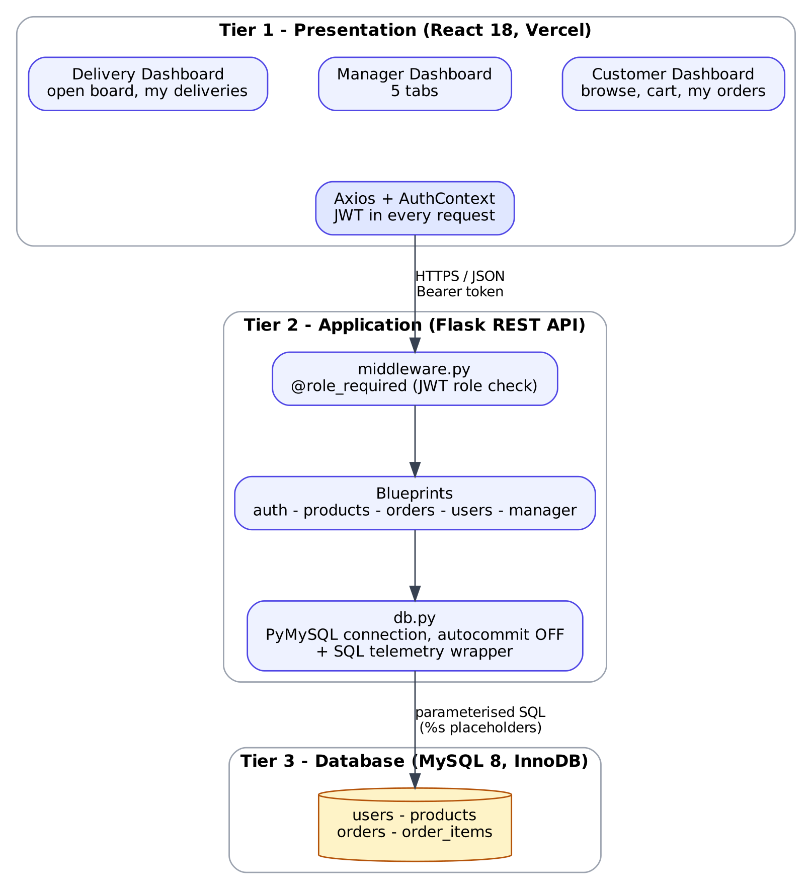</p>

<p align="center"><em>Figure 4.1: Three-tier architecture of IDS</em></p>

### 4.2 Role-Based Access Control

A user's role is **derived from the e-mail domain**; there is no separate roles table. At login the server computes the role, places it in the JWT, and the `@role_required` decorator on each endpoint compares it with the roles allowed for that endpoint. A wrong role returns HTTP 403; a missing or invalid token returns 401.

**Table 4.1: Role resolution and dashboards**

| E-mail domain | Role | Landing page | Extra data at registration |
| --- | --- | --- | --- |
| `@manager.com` | Manager | /manager | - |
| `@delpart.com` | Delivery Partner | /delivery | Vehicle type: Two-Wheeler, Van or Truck (mandatory) |
| Any other domain | Customer | /customer | - |

On the front end, `ProtectedRoute` redirects a user who opens another role's page. The front end check is only for convenience; the real enforcement is in the API.

### 4.3 Data Flow Diagrams

The context diagram shows IDS as one process exchanging information with its three external entities.

<p align="center">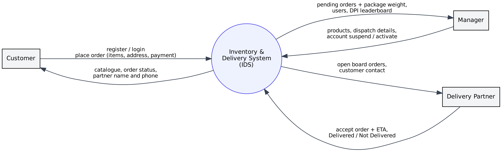</p>

<p align="center"><em>Figure 4.2: Level 0 DFD (context diagram)</em></p>

Level 1 breaks the system into four processes. Each reads or writes specific tables, which shows clearly which part of the system touches which data.

<p align="center">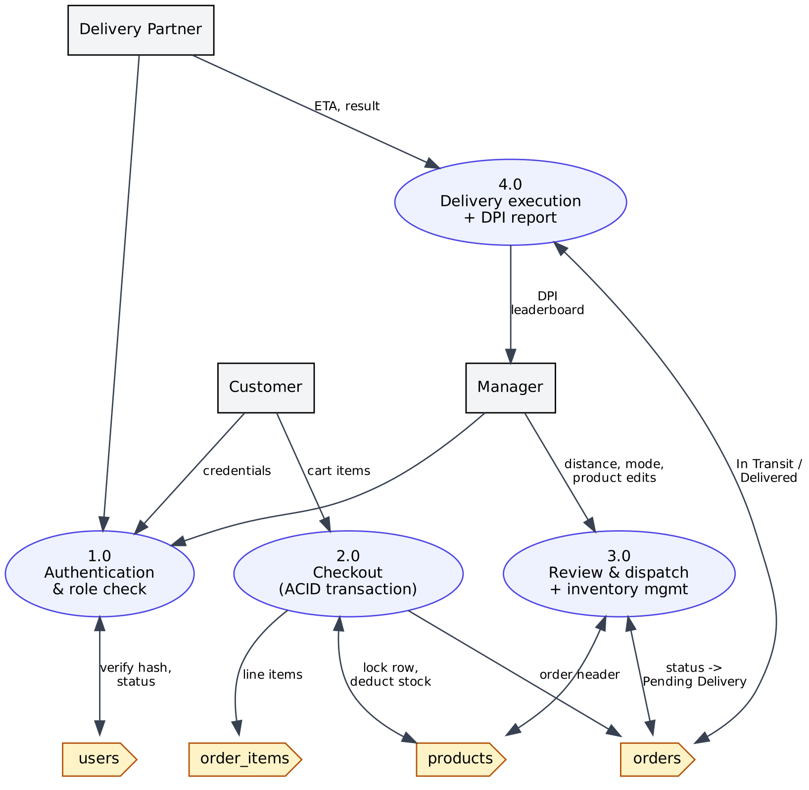</p>

<p align="center"><em>Figure 4.3: Level 1 DFD showing processes and data stores</em></p>

### 4.4 Order Lifecycle

Every order moves through a fixed set of states. Each transition is performed by exactly one role and is implemented as a single guarded `UPDATE` (Section 7.3).

<p align="center">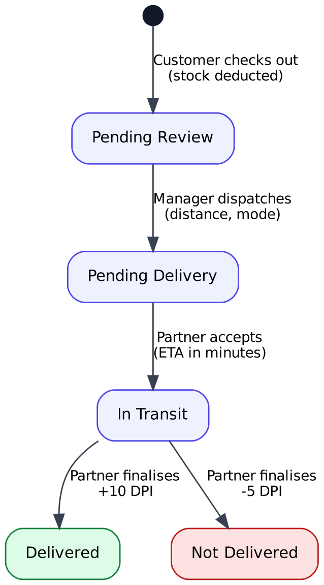</p>

<p align="center"><em>Figure 4.4: Order state transition diagram</em></p>

**Table 4.2: Transitions, owners and database effect**

| From | To | Done by | Effect in the database |
| --- | --- | --- | --- |
| (new) | Pending Review | Customer | Stock deducted; rows added to `orders` and `order_items` |
| Pending Review | Pending Delivery | Manager | Sets `distance_km`, `dispatch_mode` and optionally `partner_id` |
| Pending Delivery | In Transit | Delivery Partner | Sets `partner_id` and `estimated_delivery` |
| In Transit | Delivered / Not Delivered | Delivery Partner | Final status; counted by the DPI query |

---

## 5. Database Design

### 5.1 Entity-Relationship Model

IDS has four entities. **users** holds all three kinds of user in one table, since they share the same attributes; the role comes from the e-mail domain and only delivery partners have a `vehicle_type`. **products** is the catalogue and the stock ledger. **orders** is the order header: who ordered, where it goes, how it is dispatched and its status. **order_items** holds the lines of an order and is the associative entity that resolves the many-to-many relationship between orders and products.

<p align="center">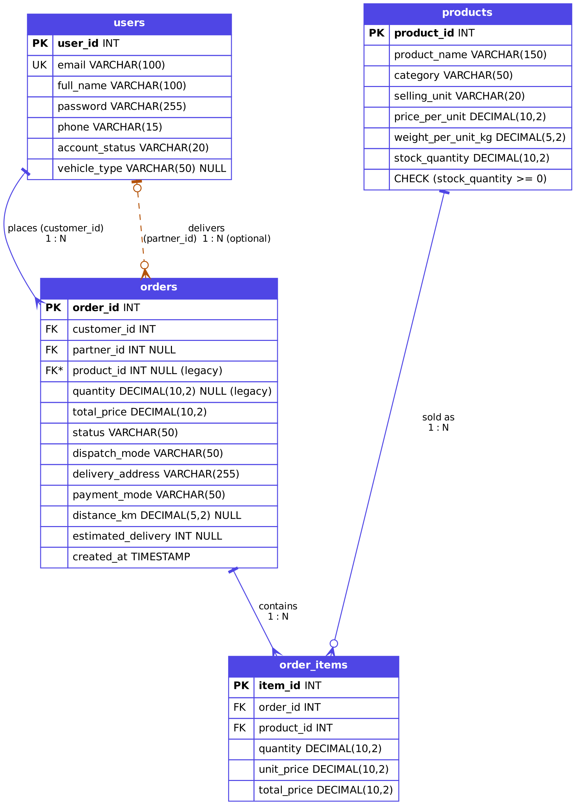</p>

<p align="center"><em>Figure 5.1: ER diagram of IDS (crow's foot notation)</em></p>

`FK*` marks the legacy `product_id` column in `orders` (explained in Section 6.4). The dashed line is optional because `partner_id` stays NULL until a driver is assigned.

### 5.2 Relationships and Constraints

**Table 5.1: Relationships**

| Relationship | Cardinality | Foreign key | On delete |
| --- | --- | --- | --- |
| User places Order | 1 : N | `orders.customer_id` -> `users.user_id` | RESTRICT (a user with orders cannot be deleted) |
| User (driver) delivers Order | 1 : N, optional | `orders.partner_id` -> `users.user_id` | SET NULL |
| Order contains Items | 1 : N | `order_items.order_id` -> `orders.order_id` | CASCADE (items go with the order) |
| Product appears in Items | 1 : N | `order_items.product_id` -> `products.product_id` | RESTRICT (a sold product cannot be deleted) |
| Product in legacy order column | 1 : N | `orders.product_id` -> `products.product_id` | SET NULL |

Other integrity rules enforced by the schema: `users.email` is **UNIQUE**; `products.stock_quantity` has `CHECK (stock_quantity >= 0)`; `account_status` defaults to `Active`; new orders default to `Pending Review`; `created_at` defaults to the current timestamp. Valid categories, units, vehicle types, dispatch modes, ETA and distance limits are validated in the API code rather than in the database (see limitations).

### 5.3 Relational Schema

The first attribute of each relation is its primary key; foreign keys are marked (FK).

```text
users       (user_id, full_name, email [UNIQUE], password, phone,
             account_status, vehicle_type)
products    (product_id, product_name, category, selling_unit,
             price_per_unit, weight_per_unit_kg, stock_quantity)
orders      (order_id, customer_id (FK users), partner_id (FK users),
             product_id (FK products), quantity, total_price, status,
             dispatch_mode, delivery_address, payment_mode,
             distance_km, estimated_delivery, created_at)
order_items (item_id, order_id (FK orders), product_id (FK products),
             quantity, unit_price, total_price)
```

### 5.4 Data Dictionary

**Table 5.2: Table users**

| Column | Type | Null | Key | Description |
| --- | --- | --- | --- | --- |
| `user_id` | INT (auto) | No | PK | Unique user identifier |
| `full_name` | VARCHAR(100) | No |  | Full name |
| `email` | VARCHAR(100) | No | UK | Login name; its domain decides the role |
| `password` | VARCHAR(255) | No |  | PBKDF2-SHA256 salted hash, never plain text |
| `phone` | VARCHAR(15) | No |  | Contact number (shown to the matching customer or driver) |
| `account_status` | VARCHAR(20) | No |  | `Active` (default) or `Suspended` |
| `vehicle_type` | VARCHAR(50) | Yes |  | Two-Wheeler, Van or Truck; only for delivery partners |

**Table 5.3: Table products**

| Column | Type | Null | Key | Description |
| --- | --- | --- | --- | --- |
| `product_id` | INT (auto) | No | PK | Unique product identifier |
| `product_name` | VARCHAR(150) | No |  | Product name |
| `category` | VARCHAR(50) | No |  | Grocery, Electronics, Smartphones, Accessories, Wearables or General |
| `selling_unit` | VARCHAR(20) | No |  | kg, liter, piece or box |
| `price_per_unit` | DECIMAL(10,2) | No |  | Price in rupees per selling unit |
| `weight_per_unit_kg` | DECIMAL(5,2) | No |  | Weight of one unit in kilograms |
| `stock_quantity` | DECIMAL(10,2) | No |  | Units in stock; `CHECK >= 0`, default 0.00 |

**Table 5.4: Table orders**

| Column | Type | Null | Key | Description |
| --- | --- | --- | --- | --- |
| `order_id` | INT (auto) | No | PK | Unique order identifier |
| `customer_id` | INT | No | FK | The customer who placed the order |
| `product_id` | INT | Yes | FK | Legacy: first product of the order (kept for old records) |
| `quantity` | DECIMAL(10,2) | Yes |  | Legacy: quantity of that first product |
| `total_price` | DECIMAL(10,2) | No |  | Grand total of the order |
| `status` | VARCHAR(50) | No |  | Pending Review, Pending Delivery, In Transit, Delivered, Not Delivered |
| `dispatch_mode` | VARCHAR(50) | No |  | `Pending Review`, `General`, `Exclusive:<vehicle>` (a direct-assigned order keeps `Exclusive` with `partner_id` set) |
| `partner_id` | INT | Yes | FK | Assigned or accepting delivery partner |
| `delivery_address` | VARCHAR(255) | No |  | Delivery address typed by the customer |
| `payment_mode` | VARCHAR(50) | No |  | Cash on Delivery, UPI, Credit Card, Debit Card or Net Banking |
| `distance_km` | DECIMAL(5,2) | Yes |  | Route distance set by the manager (minimum 0.1 km in the API) |
| `estimated_delivery` | INT | Yes |  | ETA in minutes set by the driver (minimum 1 in the API) |
| `created_at` | TIMESTAMP | No |  | Order time, default `CURRENT_TIMESTAMP` |

**Table 5.5: Table order_items**

| Column | Type | Null | Key | Description |
| --- | --- | --- | --- | --- |
| `item_id` | INT (auto) | No | PK | Unique line identifier |
| `order_id` | INT | No | FK | Parent order (`ON DELETE CASCADE`) |
| `product_id` | INT | No | FK | Product bought (`ON DELETE RESTRICT`) |
| `quantity` | DECIMAL(10,2) | No |  | Quantity ordered; decimal because kg and litres can be fractional |
| `unit_price` | DECIMAL(10,2) | No |  | Price per unit **at the time of purchase** |
| `total_price` | DECIMAL(10,2) | No |  | Line total = quantity x unit_price |

### 5.5 Seed Data

The schema script creates the database and loads demonstration data: six users (one manager, three customers and two delivery partners with a Two-Wheeler and a Van) and thirteen products across the six categories, with realistic prices, unit weights and stock. The login page offers one-click demo accounts for each role.

**Table 5.6: Demonstration accounts**

| Name | E-mail | Role |
| --- | --- | --- |
| Tanishk Yadav | tanishk@manager.com | Manager |
| Agam Jain | agam@customer.com | Customer |
| Saksham Chauhan | chauhan@delpart.com | Delivery Partner (Two-Wheeler) |
| Rishabh | rishabh@delpart.com | Delivery Partner (Van) |

---

## 6. Normalization

### 6.1 Functional Dependencies

- **users:** `user_id` -> all other attributes; `email` -> all other attributes (email is a candidate key).
- **products:** `product_id` -> `product_name`, `category`, `selling_unit`, `price_per_unit`, `weight_per_unit_kg`, `stock_quantity`.
- **orders:** `order_id` -> all other attributes.
- **order_items:** `item_id` -> all other attributes; also `quantity`, `unit_price` -> `total_price`.

### 6.2 Why Normalize

Imagine one wide table holding order, customer, product and driver details in every row. Changing a product's price would mean editing every order row (update anomaly); a new product could not be stored until someone ordered it (insertion anomaly); deleting the only order for a product would erase the product's details (deletion anomaly). Splitting the data into the four tables above removes these anomalies.

### 6.3 Normal Forms Applied to IDS

**Table 6.1: Normal-form check per table**

| Table | 1NF | 2NF | 3NF | Comment |
| --- | --- | --- | --- | --- |
| users | Yes | Yes | Yes | Every determinant (`user_id`, `email`) is a key. Also in BCNF. |
| products | Yes | Yes | Yes | Single-attribute key; no dependency between non-key columns. Also in BCNF. |
| orders | Yes | Yes | Yes, with caveats | Keyed by `order_id`. Contains two deliberately kept redundancies (Section 6.4). |
| order_items | Yes | Yes | Mostly | `total_price` is derivable from `quantity` and `unit_price` (Section 6.4). |

**1NF:** every column holds a single atomic value and there are no repeating groups. A multi-item order is not stored as a list inside `orders`; each product is its own row in `order_items`. **2NF:** the primary key of every table is a single column, so no non-key attribute can depend on part of a key. **3NF:** non-key attributes depend only on the key. The customer's name or phone is not copied into `orders`; the driver's details are not copied either; they are read through a join on `customer_id` and `partner_id`.

### 6.4 Deliberate Redundancy

A strict reading shows a few places where IDS stores a value that could be derived. They are listed here honestly, with the reason for each.

**Table 6.2: Intentional denormalization**

| Column(s) | Why it exists | Risk and handling |
| --- | --- | --- |
| `order_items.unit_price` | A **price snapshot**: the customer must be charged, and later shown, the price at purchase time even if the catalogue price changes. This is not redundancy in the harmful sense. | None; the value is intentionally independent of `products.price_per_unit` after checkout. |
| `order_items.total_price` | Precomputed `quantity x unit_price` so totals can be read without arithmetic. It makes `order_items` fall short of strict 3NF because of the dependency `quantity, unit_price -> total_price`. | Written once, inside the checkout transaction, from the same values; never updated afterwards. |
| `orders.total_price` | Sum of the order's line totals, stored on the header for fast listing. | Calculated and inserted in the same transaction as the lines. |
| `orders.product_id`, `orders.quantity` | Legacy columns from the first, single-item version of the project, kept so older rows still display. New orders copy the first product here. | Marked nullable; the application reads items from `order_items` and uses these columns only as a fallback. |
| `orders.dispatch_mode` | Stores both the mode and the vehicle filter in one string, for example `Exclusive:Van`. | Simple to query; a cleaner design would use a separate `vehicle_filter` column (future scope). |

### 6.5 Decomposition Properties

The split of order data into `orders` and `order_items` is **lossless**: the common attribute `order_id` is the key of `orders`, so joining the two tables on it returns exactly the original rows and no spurious ones. All foreign-key relationships are enforced inside single tables or by foreign key constraints, so every dependency can be checked without extra machinery (dependency preservation).

---

## 7. Implementation

### 7.1 Project Structure

**Table 7.1: Main files of the repository**

| File | Role |
| --- | --- |
| `backend/app.py` | Creates the Flask app, JWT, CORS, registers blueprints, adds the SQL telemetry header, runs the startup migration |
| `backend/config.py` | Reads settings from `.env`: database, JWT, role domains, DPI weights, limits |
| `backend/db.py` | Opens PyMySQL connections (autocommit off); wraps the cursor to record executed SQL |
| `backend/middleware.py` | `@role_required` decorator that checks the JWT role claim |
| `backend/auth.py` | Register and login; role from e-mail domain; password hashing; suspended-account check |
| `backend/routes/products.py` | Product list (with category filter), add, update, delete |
| `backend/routes/orders.py` | Place order, my orders, pending review, dispatch, all orders, open board, accept, finalize, my deliveries |
| `backend/routes/users.py` | User list by role, suspend / activate toggle, delivery-partner list |
| `backend/routes/manager.py` | DPI leaderboard query |
| `backend/migrate_db.py` | Idempotent upgrade script: creates `order_items`, relaxes legacy columns, back-fills old orders |
| `backend/schema.sql` | DDL and seed data |
| `frontend/src/pages/*` | Login, Customer, Manager and Delivery dashboards |
| `frontend/src/components/SqlQueryToast.jsx` | Pop-up that displays the SQL executed for the last request |

### 7.2 REST API

**Table 7.2: API endpoints**

| Method and path | Role | Purpose |
| --- | --- | --- |
| POST `/api/register`, `/api/login` | Public | Create account; obtain JWT |
| GET `/api/products` | Any logged-in | Catalogue, optional `?category=` |
| POST / PUT / DELETE `/api/products` | Manager | Add, edit, remove products |
| POST `/api/place-order` | Customer | Multi-item checkout (transaction) |
| GET `/api/orders/my` | Customer | Own orders with items and partner contact |
| GET `/api/orders/pending-review` | Manager | Orders awaiting dispatch with package weight |
| PUT `/api/orders/<id>/dispatch` | Manager | Set distance and mode; status to Pending Delivery |
| GET `/api/orders/all` | Manager | Every order, optional `?status=` |
| GET `/api/orders/open-board` | Delivery Partner | Eligible Pending Delivery orders |
| PUT `/api/orders/<id>/accept` | Delivery Partner | Accept with ETA; status to In Transit |
| PUT `/api/orders/<id>/finalize` | Delivery Partner | Delivered or Not Delivered |
| GET `/api/orders/my-deliveries` | Delivery Partner | Own delivery history |
| GET `/api/users`, PUT `/api/users/<id>/suspend` | Manager | List users; toggle Active / Suspended |
| GET `/api/delivery-partners` | Manager | Active drivers for the dispatch dropdown |
| GET `/api/manager/dpi` | Manager | Driver leaderboard |

### 7.3 Key SQL Queries

All queries below are taken from the source code. Values are passed as `%s` parameters, never concatenated into the SQL text.

#### 7.3.1 Login lookup and role-filtered user lists

```sql
SELECT * FROM users WHERE email = %s;           -- uses the unique index uq_email

SELECT user_id, full_name, email, phone, account_status, vehicle_type
FROM users
WHERE email NOT LIKE '%@manager.com'
  AND email NOT LIKE '%@delpart.com'          -- i.e. customers
ORDER BY user_id;
```

#### 7.3.2 Catalogue with category filter

```sql
SELECT * FROM products WHERE category = %s ORDER BY product_name;
```

*Relational algebra: π product_name, price_per_unit ( σ category = "Electronics" ( products ) ).*

#### 7.3.3 Order lines with weights (three-table join)

```sql
SELECT oi.item_id, oi.order_id, oi.product_id, oi.quantity,
       oi.unit_price, oi.total_price, p.product_name, p.category,
       p.selling_unit, p.weight_per_unit_kg,
       ROUND(oi.quantity * p.weight_per_unit_kg, 2) AS item_weight_kg
FROM order_items oi
JOIN products p ON oi.product_id = p.product_id
WHERE oi.order_id IN (%s, %s, ...)
ORDER BY oi.item_id;
```

The application adds up `item_weight_kg` to give the **package weight** that the manager sees before dispatching.

#### 7.3.4 Customer order history (outer joins)

```sql
SELECT o.*, p.product_name, p.selling_unit, p.weight_per_unit_kg, p.price_per_unit,
       u.full_name AS partner_name, u.phone AS partner_phone
FROM orders o
LEFT JOIN products p ON o.product_id = p.product_id
LEFT JOIN users    u ON o.partner_id  = u.user_id
WHERE o.customer_id = %s
ORDER BY o.created_at DESC;
```

LEFT JOIN keeps orders that do not yet have a driver (`partner_id` is NULL).

#### 7.3.5 Open delivery board

```sql
SELECT vehicle_type FROM users WHERE user_id = %s;     -- the driver's vehicle

SELECT o.*, p.product_name, c.full_name AS customer_name
FROM orders o
LEFT JOIN products p ON o.product_id = p.product_id
JOIN users c ON o.customer_id = c.user_id
WHERE o.status = 'Pending Delivery'
  AND ( o.dispatch_mode = 'General'
     OR o.partner_id    = %s                  -- directly assigned to me
     OR o.dispatch_mode = 'Exclusive:' + my vehicle type )
ORDER BY o.created_at ASC;
```

#### 7.3.6 Delivery Performance Index

DPI = (10 x Delivered) - (5 x Not Delivered) + total kilometres. The three weights are configurable in `config.py`. The query uses conditional aggregation and a LEFT JOIN so that drivers with no orders still appear with a score of zero.

```sql
SELECT u.user_id, u.full_name, u.vehicle_type,
       COUNT(CASE WHEN o.status = 'Delivered'     THEN 1 END) AS successful,
       COUNT(CASE WHEN o.status = 'Not Delivered' THEN 1 END) AS failed,
       COALESCE(SUM(o.distance_km), 0)                         AS total_km,
       ( 10.0 * COUNT(CASE WHEN o.status = 'Delivered'     THEN 1 END)
        - 5.0 * COUNT(CASE WHEN o.status = 'Not Delivered' THEN 1 END)
        + 1.0 * COALESCE(SUM(o.distance_km), 0) )              AS dpi
FROM users u
LEFT JOIN orders o ON u.user_id = o.partner_id
WHERE u.email LIKE '%@delpart.com'
GROUP BY u.user_id, u.full_name, u.vehicle_type
ORDER BY dpi DESC;
```

> **Worked example.** A driver with 4 delivered orders, 1 failed order and 18.5 km in total scores 10 x 4 - 5 x 1 + 18.5 = **53.5**. A driver with no orders scores 0.0, which is what the leaderboard screenshot in Chapter 8 shows for the two seeded drivers.

### 7.4 Transaction Management

#### 7.4.1 Checkout as one ACID transaction

Placing an order changes several tables and must not leave a half-finished result. The endpoint therefore runs the whole checkout inside one transaction.

<p align="center">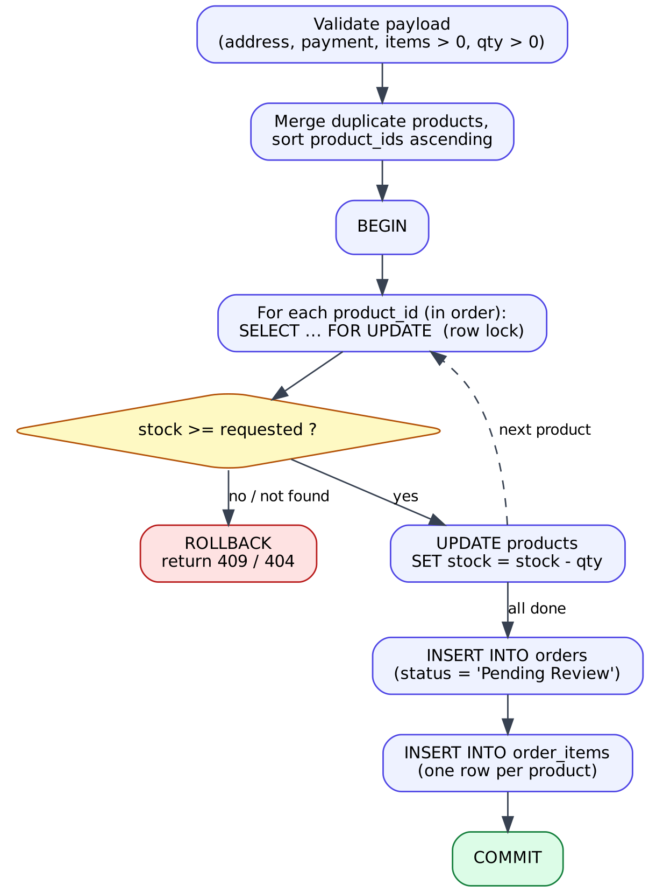</p>

<p align="center"><em>Figure 7.1: Checkout transaction flow in place_order</em></p>

**Table 7.3: ACID properties in checkout**

| Property | How IDS provides it |
| --- | --- |
| Atomicity | Stock updates, the order header and all order lines commit together; any failure triggers `ROLLBACK` and the stock is restored by the database. |
| Consistency | `CHECK (stock_quantity >= 0)`, foreign keys and the explicit stock test keep the database valid before and after. |
| Isolation | `SELECT ... FOR UPDATE` locks each product row until commit, so concurrent buyers of the same product are serialised. (InnoDB's default isolation level is REPEATABLE READ.) |
| Durability | After `COMMIT`, InnoDB's redo log guarantees the order survives a crash. |

#### 7.4.2 Deadlock avoidance

Suppose customer A buys products 1 and 2 while customer B buys 2 and 1. If each locked rows in the order given, A could hold product 1 and wait for 2 while B holds 2 and waits for 1, which is a deadlock. IDS removes the possibility by **merging duplicate products and sorting the product IDs in ascending order before locking**. Every transaction now acquires locks in the same global order, so a circular wait cannot form.

```python
# always lock in ascending product_id order
sorted_pids = sorted(item_quantities.keys())
for pid in sorted_pids:
    cur.execute(
        "SELECT ... FROM products WHERE product_id = %s FOR UPDATE", (pid,))
```

#### 7.4.3 Guarded updates for dispatch, accept and finalize

The three status changes after checkout are single `UPDATE` statements whose `WHERE` clause includes the **expected current status**. Because InnoDB takes a row lock for the update, only one of two competing requests can match the row; the other finds that zero rows changed and receives an error.

```sql
-- Manager dispatch
UPDATE orders
SET distance_km = %s, dispatch_mode = %s, partner_id = %s,
    status = 'Pending Delivery'
WHERE order_id = %s AND status = 'Pending Review';

-- Driver accepts: two drivers cannot both win
UPDATE orders
SET partner_id = %s, estimated_delivery = %s, status = 'In Transit'
WHERE order_id = %s AND status = 'Pending Delivery';

-- Driver finalizes: only the assigned driver, only from In Transit
UPDATE orders SET status = %s
WHERE order_id = %s AND partner_id = %s AND status = 'In Transit';
```

### 7.5 Security

- **Password storage:** `generate_password_hash(..., method="pbkdf2:sha256")` stores a salted hash (the seed data uses 1,000,000 iterations). Login uses `check_password_hash`.
- **SQL injection:** all values are bound as parameters. The only dynamically built statement is the product update, where column names come from a fixed whitelist and values are still parameters.
- **Authentication and authorization:** JWT access tokens carry the role; `@role_required` guards every protected endpoint.
- **Account suspension:** a manager can suspend any user; a suspended user is refused at login with HTTP 403.
- **Referential protection:** products that appear in orders cannot be deleted, and users with orders cannot be deleted.

### 7.6 SQL Telemetry for Demonstration

To make the database layer visible, `db.py` wraps the cursor and records every query and its parameters for the current request. `app.py` returns them in an `X-Executed-Queries` response header, and the front end shows them in a **SQL Executed** pop-up on every screen. Examples are visible in the screenshots of Chapter 8. The feature is switched by the `SHOW_SQL_QUERIES` setting.

### 7.7 Schema Migration

The first version of the project stored one product per order. When multi-item carts were added, `migrate_db.py` was written to upgrade an existing database safely: it creates `order_items` with `CREATE TABLE IF NOT EXISTS`, makes the old `orders.product_id` and `orders.quantity` nullable, and copies every old single-item order into `order_items` with an `INSERT ... SELECT` that skips orders already migrated. Because each step is idempotent, the script can be run repeatedly, and `app.py` runs it at start-up.

### 7.8 Deployment

The React application and the Flask API are deployed on Vercel and use a cloud-hosted MySQL database. The live demo is at **dbms-plum.vercel.app** and the source code is at **github.com/tanishkyadav1617/DBMS**. Database credentials and the JWT secret are supplied through environment variables and are not stored in the repository.

---

## 8. Results and Screenshots

The following screenshots were taken from the deployed application. The SQL Executed pop-up in the lower right corner of most screens is the telemetry feature described in Chapter 7.

<p align="center">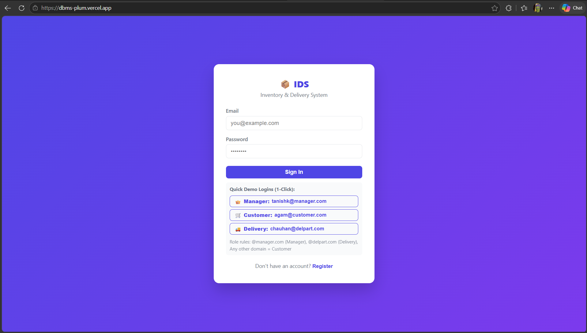</p>

<p align="center"><em>Figure 8.1: Login page with one-click demo accounts for each role</em></p>

The login page shows the role rules (`@manager.com`, `@delpart.com`, any other domain for customers) and offers a registration link.

<p align="center">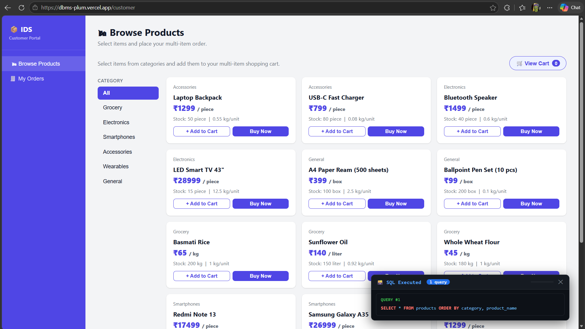</p>

<p align="center"><em>Figure 8.2: Customer dashboard: product catalogue with category filter, cart and Buy Now</em></p>

The catalogue lists price, unit, stock and unit weight for each product. The pop-up shows the query behind this screen: `SELECT * FROM products ORDER BY category, product_name`.

<p align="center">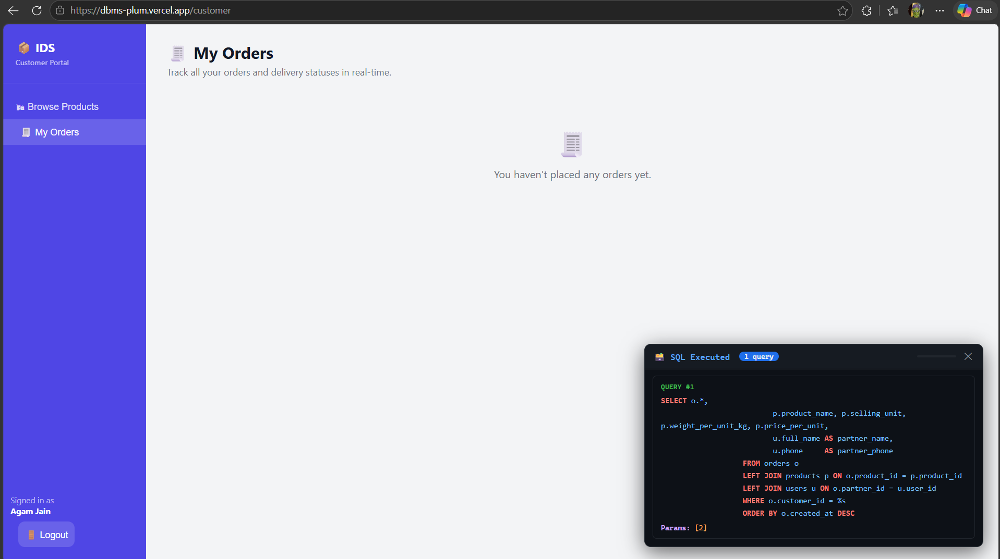</p>

<p align="center"><em>Figure 8.3: Customer dashboard: My Orders</em></p>

The query shown is the LEFT JOIN of `orders`, `products` and `users` filtered by `customer_id`. The screenshot was taken from an account with no orders, so the empty state is displayed.

<p align="center">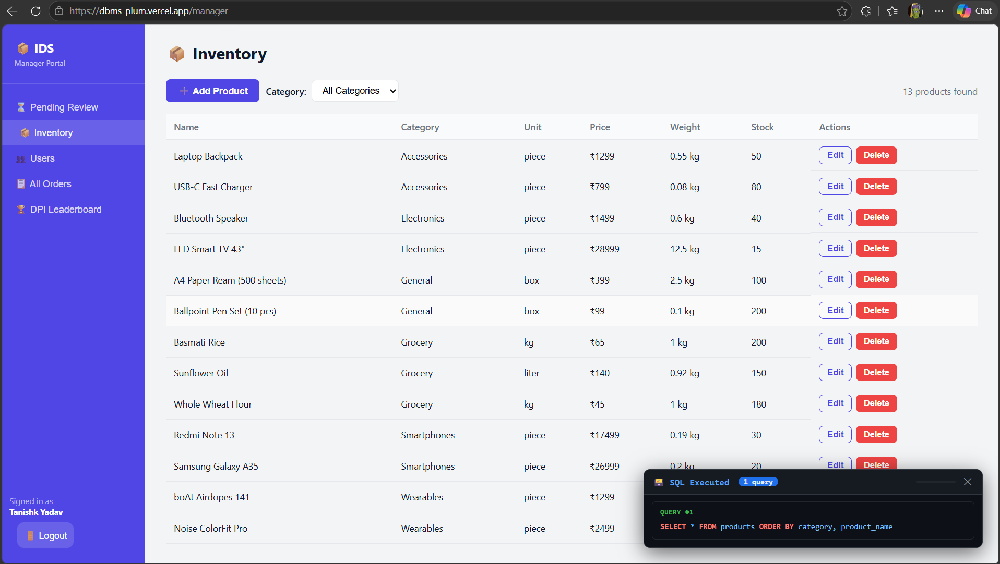</p>

<p align="center"><em>Figure 8.4: Manager dashboard: Inventory tab</em></p>

The manager can filter by category, add products, and edit or delete each row. The sidebar shows the five manager tabs: Pending Review, Inventory, Users, All Orders and DPI Leaderboard.

<p align="center">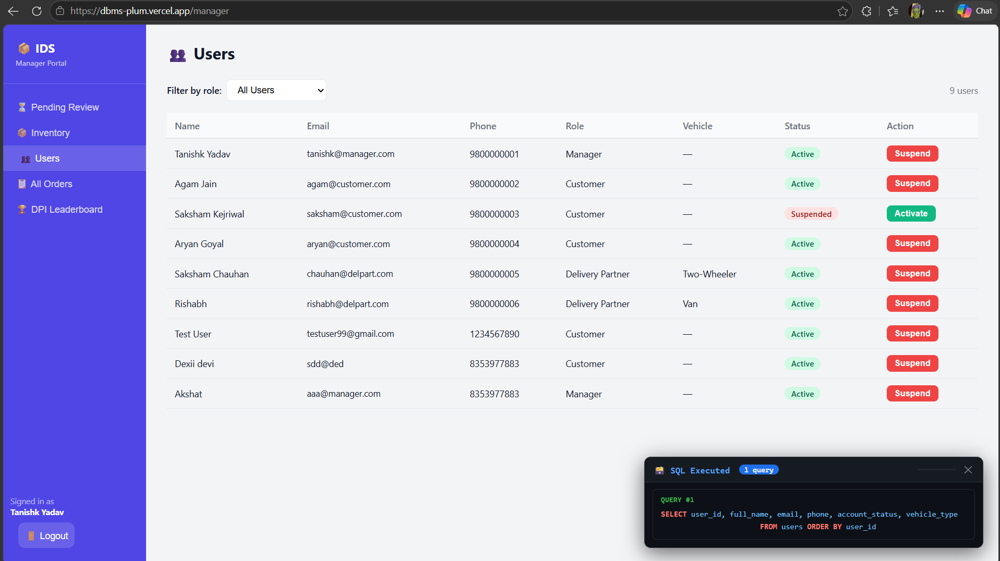</p>

<p align="center"><em>Figure 8.5: Manager dashboard: Users tab</em></p>

Users are listed with role, vehicle type and status. One customer is shown as **Suspended** with an **Activate** button, demonstrating the account control feature.

<p align="center">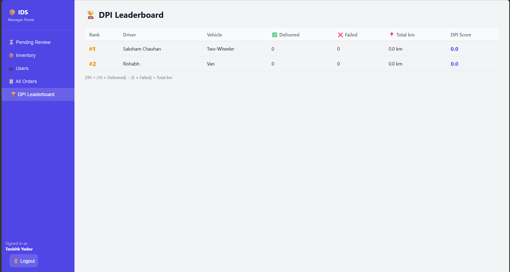</p>

<p align="center"><em>Figure 8.6: Manager dashboard: DPI leaderboard</em></p>

The leaderboard shows delivered and failed counts, total kilometres and the DPI score, with the formula printed under the table. Both drivers show 0.0 because no deliveries had been completed when the screenshot was taken.

<p align="center">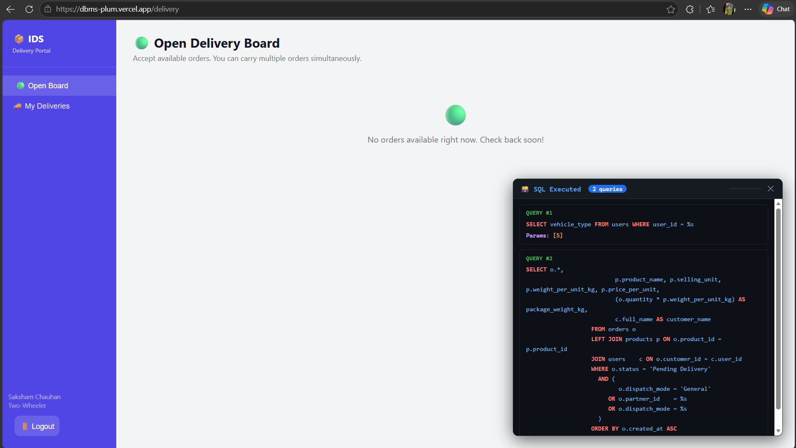</p>

<p align="center"><em>Figure 8.7: Delivery dashboard: Open Delivery Board</em></p>

The pop-up shows the two queries behind the board: first the driver's vehicle type, then the list of Pending Delivery orders that are General, directly assigned to this driver, or Exclusive for this vehicle type.

<p align="center">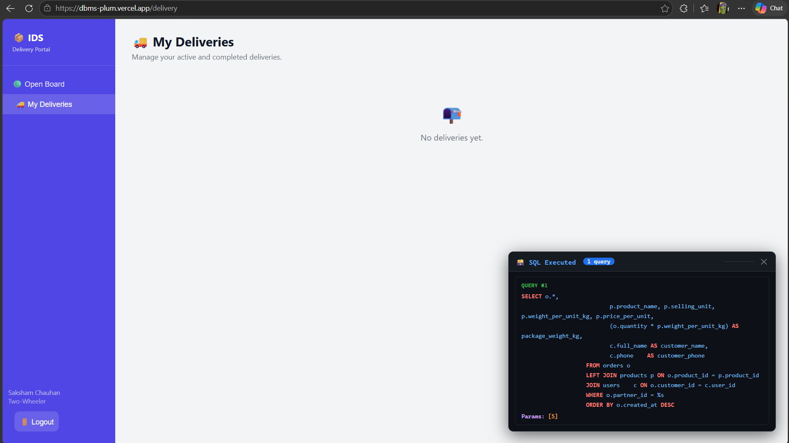</p>

<p align="center"><em>Figure 8.8: Delivery dashboard: My Deliveries</em></p>

---

## 9. Testing

The table lists the main test cases and the behaviour required by the implementation. Each case can be repeated on the live application by using the demo accounts and watching the SQL pop-up. Cases 10 to 14 need at least one order in the system, so place an order as a customer first.

**Table 9.1: Test cases**

| No. | Scenario | Input / action | Expected result |
| --- | --- | --- | --- |
| 1 | Valid login | Demo manager e-mail and password | Token issued; redirected to `/manager` |
| 2 | Wrong password | Correct e-mail, wrong password | HTTP 401, "Invalid email or password" |
| 3 | Suspended user | Login as a suspended account | HTTP 403, account suspended message |
| 4 | Duplicate registration | Register an e-mail that exists | HTTP 409, "Email already registered" |
| 5 | Driver without vehicle | Register `@delpart.com` with no vehicle type | HTTP 400, vehicle type required |
| 6 | Role and token protection | Customer token calls a manager endpoint; or no token at all | HTTP 403 (wrong role) or HTTP 401 (no token) |
| 7 | Multi-item checkout | Two products, valid address and payment | One order, two lines, stock reduced for both, status Pending Review |
| 8 | Insufficient stock | Quantity greater than stock | HTTP 409, whole order rolled back, no stock change |
| 9 | Empty address or payment | Missing `delivery_address` | HTTP 400 |
| 10 | Dispatch validation | Distance below 0.1 km, or Exclusive with no partner or vehicle | HTTP 400 |
| 11 | Double dispatch | Dispatch the same order twice | Second call HTTP 404, "already dispatched" |
| 12 | Two drivers accept | Two drivers accept one General order | Only the first succeeds; the other gets HTTP 404 |
| 13 | Exclusive visibility | Order dispatched as `Exclusive:Van` | Visible to the Van driver, not to the Two-Wheeler driver |
| 14 | Finalize by wrong driver | A different driver calls finalize | HTTP 404; status unchanged |
| 15 | Delete ordered product | Delete a product present in `order_items` | Rejected by the RESTRICT foreign key; the API returns an error |
| 16 | DPI calculation | 4 Delivered, 1 Not Delivered, 18.5 km | DPI = 53.5 |

---

## 10. Limitations

- **Role by e-mail domain:** anyone can register with an `@manager.com` address and become a manager. A real deployment would assign roles by invitation or approval.
- **No stock restoration:** a **Not Delivered** order does not return its quantity to stock, and there is no order cancellation.
- **Payments are only recorded:** the chosen payment mode is stored but no payment is processed.
- **Limited database-level validation:** category, unit, vehicle type, minimum distance and minimum ETA are checked in the API, not by `CHECK` constraints or lookup tables.
- **Packed field and legacy columns:** `dispatch_mode` mixes mode and vehicle filter, and `orders` still carries the legacy `product_id` and `quantity` columns.
- **Session settings:** tokens do not expire by default and cross-origin access is open to all origins; both should be tightened for production.
- **No automated tests, pagination or search:** testing is manual and long lists are loaded in full.
- **Distance is entered by hand:** there is no map or route calculation.

---

## 11. Future Scope

- Replace e-mail-domain roles with an explicit `role` column (or a `roles` table) and an approval flow for managers and drivers.
- Return stock automatically when an order is cancelled or marked Not Delivered; add customer cancellation within a time window.
- Add a `CHECK` or lookup tables for categories, units, vehicle types and statuses; split `dispatch_mode` into mode and vehicle filter; drop the legacy order columns after migration.
- Add indexes for frequent filters (for example `orders(status, created_at)`, `orders(partner_id)`) as data grows.
- Integrate a payment gateway and an address / map service for distance and live tracking.
- Notifications by SMS, e-mail or push when an order is dispatched, accepted or delivered.
- Automated tests, token expiry, rate limiting and an audit log of manager actions.
- Reports such as sales by category, low-stock alerts and driver performance over time.

---

## 12. Conclusion

IDS shows how a relational database can be the backbone of a small but realistic business application. The four-table schema captures users, products, orders and order lines with proper keys and referential actions. Checkout is a single ACID transaction that locks rows in a fixed order, which prevents both overselling and deadlocks. Guarded updates make dispatch, acceptance and completion safe under concurrent use. The DPI query turns raw delivery records into a meaningful performance score using joins and conditional aggregation.

The project also demonstrates practical engineering around the database: role-based access, hashed passwords, parameterised queries, an idempotent migration and a telemetry panel that exposes the SQL behind each screen. The limitations listed above point to clear next steps, and none of them changes the central design.

---

## References

1. R. Elmasri and S. B. Navathe, Fundamentals of Database Systems, 7th ed., Pearson, 2016.
2. A. Silberschatz, H. F. Korth and S. Sudarshan, Database System Concepts, 7th ed., McGraw-Hill, 2019.
3. MySQL 8.0 Reference Manual: InnoDB locking and transaction model. https://dev.mysql.com/doc/refman/8.0/en/
4. Flask documentation. https://flask.palletsprojects.com/
5. Flask-JWT-Extended documentation. https://flask-jwt-extended.readthedocs.io/
6. PyMySQL documentation. https://pymysql.readthedocs.io/
7. Werkzeug security helpers (password hashing). https://werkzeug.palletsprojects.com/
8. React documentation. https://react.dev/
9. Project source code. https://github.com/tanishkyadav1617/DBMS

---

## Appendix A: Running the Project Locally

1. Create the database and load data: `mysql -u <user> -p < backend/schema.sql`.
2. In `backend/`, copy `.env.template` to `.env`, set the database password and a secret key, then run `pip install -r requirements.txt` and `python app.py` (port 8000).
3. In `frontend/`, set `REACT_APP_API_URL` in `.env` to the API address, then run `npm install` and `npm start` (port 3000).
4. Log in with a demo account (all seed users share the password given in `schema.sql`).

---

## Appendix B: Table Definitions (DDL)

```sql
CREATE TABLE users (
  user_id INT NOT NULL AUTO_INCREMENT, full_name VARCHAR(100) NOT NULL,
  email VARCHAR(100) NOT NULL, password VARCHAR(255) NOT NULL, phone VARCHAR(15) NOT NULL,
  account_status VARCHAR(20) NOT NULL DEFAULT 'Active', vehicle_type VARCHAR(50) NULL,
  PRIMARY KEY (user_id), UNIQUE KEY uq_email (email)
) ENGINE=InnoDB;

CREATE TABLE products (
  product_id INT NOT NULL AUTO_INCREMENT, product_name VARCHAR(150) NOT NULL,
  category VARCHAR(50) NOT NULL, selling_unit VARCHAR(20) NOT NULL,
  price_per_unit DECIMAL(10,2) NOT NULL, weight_per_unit_kg DECIMAL(5,2) NOT NULL,
  stock_quantity DECIMAL(10,2) NOT NULL DEFAULT 0.00,
  PRIMARY KEY (product_id), CONSTRAINT chk_stock CHECK (stock_quantity >= 0)
) ENGINE=InnoDB;

CREATE TABLE orders (
  order_id INT NOT NULL AUTO_INCREMENT, customer_id INT NOT NULL,
  product_id INT NULL, quantity DECIMAL(10,2) NULL, total_price DECIMAL(10,2) NOT NULL,
  status VARCHAR(50) NOT NULL DEFAULT 'Pending Review',
  dispatch_mode VARCHAR(50) NOT NULL DEFAULT 'Pending Review', partner_id INT NULL,
  delivery_address VARCHAR(255) NOT NULL, payment_mode VARCHAR(50) NOT NULL,
  distance_km DECIMAL(5,2) NULL, estimated_delivery INT NULL,
  created_at TIMESTAMP NOT NULL DEFAULT CURRENT_TIMESTAMP,
  PRIMARY KEY (order_id),
  CONSTRAINT fk_orders_customer FOREIGN KEY (customer_id) REFERENCES users (user_id) ON DELETE RESTRICT,
  CONSTRAINT fk_orders_product  FOREIGN KEY (product_id)  REFERENCES products (product_id) ON DELETE SET NULL,
  CONSTRAINT fk_orders_partner  FOREIGN KEY (partner_id)  REFERENCES users (user_id) ON DELETE SET NULL
) ENGINE=InnoDB;

CREATE TABLE order_items (
  item_id INT NOT NULL AUTO_INCREMENT, order_id INT NOT NULL, product_id INT NOT NULL,
  quantity DECIMAL(10,2) NOT NULL, unit_price DECIMAL(10,2) NOT NULL, total_price DECIMAL(10,2) NOT NULL,
  PRIMARY KEY (item_id),
  CONSTRAINT fk_order_items_order   FOREIGN KEY (order_id)   REFERENCES orders (order_id) ON DELETE CASCADE,
  CONSTRAINT fk_order_items_product FOREIGN KEY (product_id) REFERENCES products (product_id) ON DELETE RESTRICT
) ENGINE=InnoDB;
```

